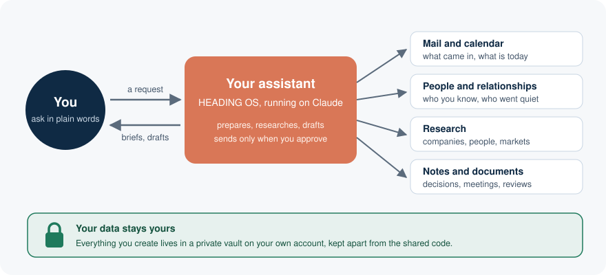
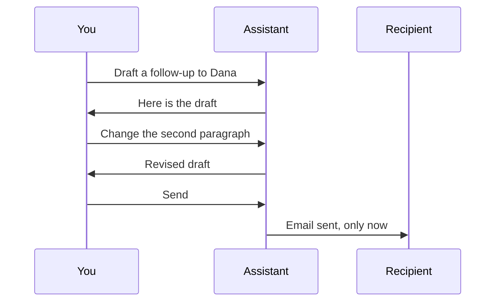
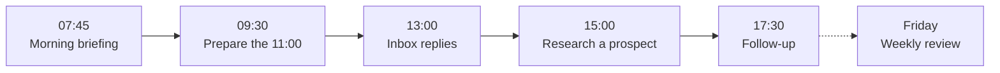
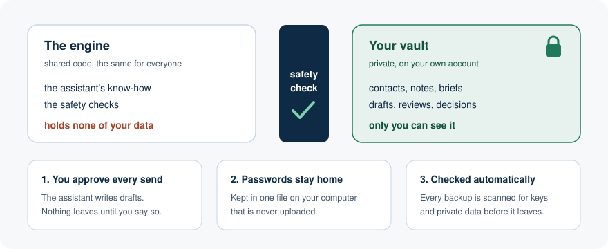
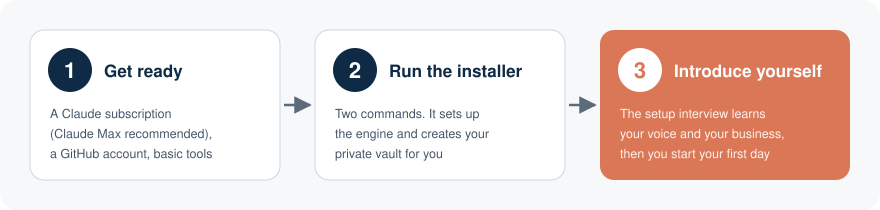

<div align="center">

# HEADING OS

**The command post an executive runs their work from, built on Claude.** It prepares every meeting, keeps track of every promise, and never sends without your say. It runs on your machine, and your data lives in your own private repository.

[](LICENSE)
[](https://claude.com/product/claude-code)

</div>

---

<p align="center"></p>

You talk to it the way you would brief a sharp assistant: "prepare me for tomorrow's meeting with the CFO of Northwind", "draft a reply to the Northwind thread", "draft a thank-you to the panel organisers". It does the legwork, shows you the result, and waits for your word before anything goes out.

It is named after one idea, the **Navigation Principle**: set a heading and hold it, correcting course as conditions change, instead of steering at a fixed point and hoping.

## Contents

1. [What changes on day one](#what-changes-on-day-one)
2. [What it does for an executive](#what-it-does-for-an-executive)
3. [A day with HEADING OS](#a-day-with-heading-os)
4. [Security in plain words](#security-in-plain-words)
5. [Install in three steps](#install-in-three-steps)
6. [Or have it installed: the VIP licence](#or-have-it-installed-the-vip-licence)
7. [Guides](#guides)
8. [Optional tools](#optional-tools)
9. [Questions executives ask](#questions-executives-ask)
10. [Status](#status)
11. [Support, contributing and contact](#support-contributing-and-contact)
12. [License](#license)

## What changes on day one

- **The preparation you never had time for.** Before Tuesday's board call, a brief on every attendee. Before the pitch, a side-by-side with the competitor you expect to meet. Before you sign, a second read of the term sheet.
- **The signal hiding between your systems.** It reads across your inbox, calendar, CRM and documents, and brings back the commitment buried in a three-week thread or the remark from Thursday that changes Monday's plan.
- **Nothing you promised falls through.** Every decision, commitment and follow-up is captured and comes back when it matters: before the next meeting with that person, before the deadline.
- **From blank page to first draft in minutes.** Letters, proposals, board updates: one sentence of intent, and a structured first draft in your voice, ready for your edit rather than your rewrite.
- **A sparring partner at 11 pm.** Stress-test a decision, have it argue the other side, rehearse a difficult negotiation before you walk in.
- **An advantage that compounds.** A recurring task you hand over once becomes a one-line request from then on.
- **Every fact shows its source.** An answer from your records or from research points back to the email, file or record it came from.

You start where a mistake costs nothing (research, meeting prep, summaries, drafts) and hand over more as your confidence grows. The executives making the best AI decisions for their companies are the ones who use it themselves.

## What it does for an executive

Each scenario below is a command you type, or the same request in your own words. You never have to remember the commands: ask in plain English and HEADING OS picks the right one.

### 1. Walk into every meeting prepared

| Before | With HEADING OS |
|---|---|
| Twenty minutes before the call you search old emails, skim LinkedIn and try to remember what you promised last time. | One request gives you a brief: who they are, your history with them, past correspondence, what they are likely to push for, and three questions worth asking. |

```text
/meeting-prep Dana Whitfield, CFO of Northwind Logistics, contract renewal
```

### 2. Start the day with one page

| Before | With HEADING OS |
|---|---|
| Calendar in one window, inbox in another, a pipeline spreadsheet somewhere else. | A single morning briefing: today's meetings, the latest mail, relationships that need attention, deals in motion, and anything that has gone stale. |

```text
/dashboard
```

### 3. Clear the inbox without writing every reply yourself

| Before | With HEADING OS |
|---|---|
| Forty replies to write, each one needing the right tone. | Point it at a message and get a reply drafted in your voice, which reads what the sender actually wants and answers that. You edit, approve, and it goes. |

```text
/email-respond keep it short, offer two slots next week
```

### 4. Know a company before you reply to it

| Before | With HEADING OS |
|---|---|
| A new partner writes in. You have no idea who owns them, how big they are, or who else they work with. | A dossier with sources and a confidence rating on each finding, plus what it means for your business. |

```text
/osint Northwind Logistics
```

### 5. Drafts in your voice that never leave without you

| Before | With HEADING OS |
|---|---|
| Every important email is either delegated and sounds wrong, or written by you at 11 pm. | It learns how you write during setup, then drafts emails and follow-ups that sound like you. **It cannot send on its own.** You read the draft and say send. |

```text
/email-draft Dana Whitfield, confirm renewal terms and next steps
/follow-up Dana Whitfield, after today's renewal meeting
```



### 6. Never let an important relationship go quiet

| Before | With HEADING OS |
|---|---|
| You notice six months later that a key investor has not heard from you since spring. | It keeps track of who you know and when you last spoke, and tells you who is due a call. |

```text
/crm radar
```

### 7. Think a hard decision through

| Before | With HEADING OS |
|---|---|
| A big choice, three options, and a head full of half-tested assumptions. | A decision paper: the real question, which assumptions are tested and which are guesses, the options weighed against evidence, and a clear recommendation with what would change it. |

```text
/deep-think open a second office in Singapore this year, or wait until next spring
```

### 8. Close the week with a real review

| Before | With HEADING OS |
|---|---|
| Friday afternoon passes and the week is gone with no record of what moved. | A weekly review: how the week went, which deals moved, your top three priorities for next week, and the course corrections, compared with last week's review. |

```text
/weekly-review
```

There is more inside, including LinkedIn posts in your voice, event debriefs, negotiation coaching, presentations and a searchable memory of everything you have worked on. Type `/next` at any time and it suggests the sensible next step.

## A day with HEADING OS



**07:45, coffee.** You open your assistant and type `/dashboard`.

```text
You:        /dashboard
Assistant:  Three meetings today. The 11:00 with Northwind is the one that matters:
            their renewal is due in 19 days. Two emails need you before noon.
            You have not spoken to your lead investor in 41 days.
```

**09:30, before the big meeting.**

```text
You:        Prepare me for the 11:00 with Dana Whitfield at Northwind.
Assistant:  Brief ready. Dana joined as CFO in March and has asked twice about
            payment terms. Last call you promised a revised price sheet; it
            was never sent. Suggested opener and three questions are inside.
```

**13:00, the inbox.** You forward two messages and ask for replies. Both come back in your tone. You change one sentence, approve, and they go.

**15:00, a new name.** A company you have never heard of asks for a call. `/osint` returns who owns it, what it does and whether it competes with you, each claim with its source.

**17:30, after the meeting.** `/follow-up Dana Whitfield` drafts the thank-you with the price sheet you promised. You read it and send it.

**Friday.** `/weekly-review` turns the week into two pages you can act on next Monday.

## Security in plain words

<p align="center"></p>

- **Your data and the code live apart.** The engine is identical on every installation and holds nothing of yours. Your contacts, notes, briefs and drafts sit in a private vault of their own, a separate folder that only your account can open, so an update to the engine can never carry your data out with it.
- **Nothing is sent without your approval.** The assistant drafts. You decide. Every email or message addressed to another person waits for your word, and the only messages it ever sends unprompted are reminders to you.
- **Passwords stay on your computer.** They live in one local file that is never uploaded. Before any backup leaves your machine, it is scanned for passwords, access keys and private data, and if the scan finds one the backup simply refuses to go.
- **You can see what it keeps.** Briefs, reviews and notes are plain files in your vault. Open them, edit them, delete them.
- **Seven enforcement layers hold the line between engine and vault.** Each is a separate check, from the moment a file is written to the moment a push leaves your machine; [SECURITY.md](SECURITY.md) names all seven.

## Install in three steps

<p align="center"></p>

**A Claude Max subscription is recommended.** A single morning of meeting prep, research and drafts can mean hundreds of pages read on your behalf, and Max gives the assistant far more room before it reaches a usage limit. An Anthropic API key also works.

**Step 1. Get ready.** You need a computer running macOS 13 or later, Linux, or Windows 11 with WSL2 (Windows' built-in Linux; the guide shows how to switch it on). You also need a [Claude](https://claude.com/pricing) subscription, a free [GitHub](https://github.com) account, which is where your private vault is kept, and a few free tools. [docs/INSTALL.md](docs/INSTALL.md) lists each one with the exact command to install it.

**Step 2. Run the installer.** Open a terminal and paste these two lines:

```bash
git clone https://github.com/HEADING-OS-Official/heading-os.git ~/ai/claude-workspaces/.heading-os
bash ~/ai/claude-workspaces/.heading-os/install.sh
```

It sets up the engine, creates your private vault on your GitHub account and switches on every safety check described above. Run it twice? Nothing breaks, because each step that is already done gets skipped.

**Step 3. Introduce yourself.** Start Claude Code in the engine folder and run the setup interview, then your first session:

```text
/setup-wizard
/prime
```

`/setup-wizard` asks about you, your business and how you write, and saves the answers to your vault. `/prime` starts each working session with that context loaded.

Every option, the troubleshooting, and how to update later: **[docs/INSTALL.md](docs/INSTALL.md)**.

## Or have it installed: the VIP licence

Prefer not to install it yourself? Under the **[VIP licence](https://headingos.com/vip.html)** a team installs HEADING OS and all its components on your own infrastructure, sets it up around your mail, calendar, voice and records, and supports it for twelve months. After handover nobody from HEADING OS can see your data: you hold every key.

VIP also adds what the public version does not carry: a dedicated team that keeps the platform current, a personal enabler for your first weeks, a daily inbox digest, speaking to it and capturing from your phone, one deployment approved by IT for every executive, a Salesforce or HubSpot connection scoped with you, and results measured before and after on the workflows you repeat most. [What VIP adds](https://headingos.com/vip.html#v-adds).

The first year is from $24,850, and it starts with a call. [Request one on the site](https://headingos.com/vip.html#request); the reply comes within 48 hours.

## Guides

Once it is installed, these explain how to work with it, in plain English. They ship in [docs/](docs/), and the same guides are online at **[headingos.com/docs](https://headingos.com/docs/)**:

- **[Working with HEADING OS](docs/WORKING-WITH-HEADING-OS.md)**: the first day, an ordinary day, how a request becomes work, drafts and sending, long sessions, backups.
- **[Skills](docs/SKILLS.md)**: every skill, what each does, how to call it, with an example.
- **[Rules and protections](docs/RULES-AND-PROTECTIONS.md)**: the rules the assistant follows, the checks that refuse an action, and what to do when one does.
- **[What's new](docs/WHATS-NEW.md)**: what changed in each release.

## Optional tools

HEADING OS works on its own. Each of these adds one thing, and each has its own guide:

- **[Hindsight](docs/HINDSIGHT.md)**: long-term memory, so the assistant remembers decisions and conversations from weeks ago.
- **[Lific](docs/LIFIC.md)**: a private task list the assistant can read and update with you.
- **[Herdr](docs/HERDR.md)**: several assistants working at once, each on its own task.
- **[CLIProxyAPI](docs/CLIPROXY.md)**: second opinions from other AI models, such as ChatGPT, Gemini, Grok and Kimi.
- **[AgentView](docs/AGENTVIEW.md)**: a live view of what your assistants are doing right now.

How the parallel way of working fits together: **[docs/YARDS.md](docs/YARDS.md)**.

## Questions executives ask

**What does it cost?**
HEADING OS itself is free to download and use under its license. You pay only for Claude, and a Claude Max subscription is the one we recommend. A professionally installed and configured HEADING OS, with a year of support, is the [VIP licence](https://headingos.com/vip.html), first year from $24,850.

**Do I need a developer?**
Not to use it. Day to day you write in plain English. Installing it means pasting a short list of commands, which the [install guide](docs/INSTALL.md) gives you one at a time, in order, with what each one does. If you have never opened a terminal, ask someone technical to sit with you for the install, or use the professional installation above.

**Where does my data live?**
On your computer, in your vault folder, with a private backup under your own GitHub account. You can also keep it on your computer only. It is never stored inside the shared engine. While you work, the text the assistant is handling is processed by Claude under the terms of your Claude plan.

**Which mail and calendar does it work with?**
Microsoft Exchange mail and calendar, and Gmail. Telegram and Mattermost are supported for messages.

**What if it makes a mistake?**
It drafts, you decide. Nothing goes out without your approval, and research arrives with its sources attached, so a doubtful claim about a company or a person takes one click to check before you repeat it in a meeting. Treat it like a capable new chief of staff in their first month: trust grows as you check its work.

## Status

<!-- version: set from pyproject.toml by the official build; checked by scripts/check-version-sync.py -->
`v3.1.0`, HEADING OS 3.1. The engine and data separation and the security model are stable. Versions follow Semantic Versioning: an incompatible change raises the major number.

## Support, contributing and contact

- **Help:** [SUPPORT.md](SUPPORT.md) says where to look first and where to ask.
- **Bugs:** reports are welcome as GitHub issues; pull requests are not accepted. [CONTRIBUTING.md](CONTRIBUTING.md) explains why, and how to write a report that gets fixed.
- **Security:** never in a public issue. Write as [SECURITY.md](SECURITY.md) describes.
- **What changed:** [CHANGELOG.md](CHANGELOG.md).
- **Anything else:** `admin@headingos.com`.

## License

Free to download, install and use under PolyForm Internal Use 1.0.0 or PolyForm Noncommercial 1.0.0, your choice. It is not open source: nobody may sell HEADING OS, or paid installation or support of it, except Misha Hanin and the entities he approves in writing. To ask for a commercial licence, write to `misha.hanin@headingos.com`. Full terms: **[LICENSE](LICENSE)** and **[NOTICE](NOTICE)**, and in plain words at [headingos.com/license.html](https://headingos.com/license.html).

HEADING OS is the personal project of **[Misha Hanin](https://www.linkedin.com/in/mishahanin/)**, its initial architect, and **[Jochanan Sommerfeld](https://www.linkedin.com/in/jochanansommerfeld/)**, co-architect of the whole HEADING OS system.

Note: Misha Hanin is the Founder and CEO of 31 Concept (31C); 31 Concept is not involved in HEADING OS, does not maintain, sponsor or endorse it, and bears no responsibility for it.

<div align="center"><sub>Set a heading. Hold it.</sub></div>
